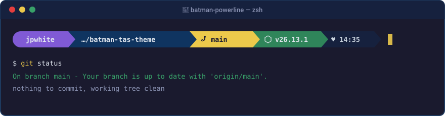
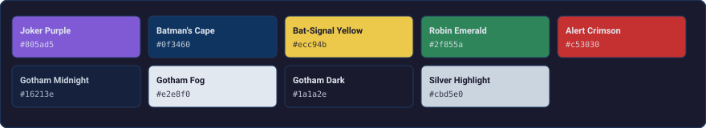

# 🦇 Starship Batman Powerline Preset

[](LICENSE)
[](https://starship.rs)
[](https://github.com/jpwhite3/batman-tas-theme)

> A high-contrast, Dark Deco [Starship](https://starship.rs/) prompt preset inspired by **Batman: The Animated Series (1990s)** and built upon the popular `pastel-powerline` layout.

<p align="center">
  
</p>

---

## The Dark Knight Prompt

`pastel-powerline` is one of Starship's most popular powerline presets, but light pastel backgrounds with default white terminal text can wash out and strain the eyes.

**Starship Batman Powerline** fixes legibility issues by pairing colors from the authentic 1990s Batman TAS palette:
- **High-contrast readability**: Dark Gotham Midnight text on bright Bat-Signal Yellow; luminous Gotham Fog text on deep villain purple, cape blue, and robin green.
- **100% Feature Parity**: Retains all Powerline glyphs, directory substitutions, git status indicators, Docker context, and 14 programming language runtimes from `pastel-powerline`.
- **Reusable Starship Palette**: Configured cleanly with a central `[palettes.batman_tas]` table.

---

## 🎨 Batman TAS Color Palette

<p align="center">
  
</p>

| Segment | Role | Background Color | Foreground Color |
|---|---|---|---|
| **OS & Username** | Start Cap / Identity |  `#805ad5` Joker Purple |  `#e2e8f0` Gotham Fog |
| **Directory** | Path & Context |  `#0f3460` Batman's Cape |  `#e2e8f0` Gotham Fog |
| **Git Branch & Status** | Version Control |  `#ecc94b` Bat-Signal Yellow |  `#1a1a2e` Gotham Dark |
| **Language Runtimes** | C, Go, Node, Rust, etc. |  `#2f855a` Robin Emerald |  `#e2e8f0` Gotham Fog |
| **Docker Context** | Containers |  `#c53030` Alert Crimson |  `#e2e8f0` Gotham Fog |
| **Time & End Cap** | System Clock / Close |  `#16213e` Gotham Midnight |  `#cbd5e0` Silver Highlight |

---

## ⚡ Quick Install

### Prerequisites
- [Starship](https://starship.rs/) installed (`starship --version`)
- A [Nerd Font](https://www.nerdfonts.com/) installed and set in your terminal (e.g. FiraCode Nerd Font, JetBrainsMono Nerd Font)

### One-Line Install (Recommended)

Run in your terminal to back up your current configuration and install the Batman Powerline preset:

```bash
# Backup existing starship configuration (if present)
[ -f ~/.config/starship.toml ] && cp ~/.config/starship.toml ~/.config/starship.toml.bak

# Download the Batman Powerline preset
curl -fsSL https://raw.githubusercontent.com/jpwhite3/starship-batman-powerline/main/starship.toml -o ~/.config/starship.toml
```

### Manual Install

```bash
# Clone the repository
git clone https://github.com/jpwhite3/starship-batman-powerline.git

# Copy into Starship's configuration directory
cp starship-batman-powerline/starship.toml ~/.config/starship.toml
```

---

## 🛠️ Supported Language Runtimes

Includes full symbol and version detection for 14+ language runtimes:
`Node.js` • `Bun` • `Rust` • `Go` • `Python` • `C/C++` • `Java` • `Kotlin` • `Gradle` • `Maven` • `Elixir` • `Elm` • `Haskell` • `Julia` • `Nim` • `Scala`

---

## 🦇 Companion VS Code Theme

Love this aesthetic in your terminal? Bring Gotham City into your code editor too with the **[Batman TAS Theme for VS Code](https://github.com/jpwhite3/batman-tas-theme)**!

---

## 📄 License

[MIT](LICENSE) © [John White (jpwhite3)](https://github.com/jpwhite3)
